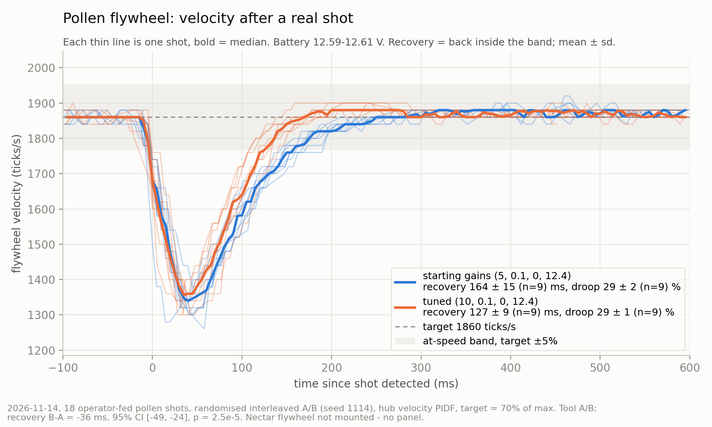

# Pollen flywheel — recovery after a real shot



**What it shows.** The pollen flywheel's velocity around each real shot, lined up on the moment
the shot is detected. Each thin line is one operator-fed pollen; the bold line is the median of
that arm. The grey band is the shipped "at speed" test (`|v − T| ≤ AT_SPEED_FRACTION · T`,
0.05) that `shooter.java` waits on before it opens the gate, so the time back inside the band is
how soon the next shot can fire.

| 2026-11-14, T = 1860 ticks/s | starting gains (5, 0.1, 0, 12.4) | tuned (10, 0.1, 0, 12.4) |
|---|---|---|
| recovery, back inside the band (traces in the figure) | 164 ± 15 ms (n = 9) | **127 ± 9 ms** (n = 9) |
| peak droop | 29 ± 2 % (n = 9) | 29 ± 1 % (n = 9) |
| recovery, Mechanism Tuner A/B (acceptance) | 163.4 ± 14.8 ms (n = 9) | 127.1 ± 10.4 ms (n = 10) |

mean ± sd. **Acceptance:** randomised interleaved real-shot A/B (`mechtune.py ab --test shots`,
seed 1114), B − A = **−36.3 ms, 95% CI [−49.0, −23.6], t = −6.12, p = 2.5e-5**, 0 failures per
arm. The droop is unchanged: it is set by the piece, not the gains; the higher P just pushes the
wheel back up faster. Battery 12.59–12.61 V across the shots in the figure (12.47–12.62 V over the
whole A/B).

**"Starting gains"**, not "hand-tuned": (5, 0.1, 0, 12.4) came out of a measured search on
2026-11-12 (`FINDINGS.md`), the values installed when this session began.

## How it was measured

- Robot: pollen flywheel on Expansion Hub motor port 1 (`pollenTurret`), the hub's own velocity
  PIDF (`RUN_USING_ENCODER`, `setVelocity`), exactly as `systems/Flywheel.java` runs it. The
  Mechanism Tuner OpMode only samples velocity, once per loop (~150 Hz here; the encoder reads in
  20 ticks/s steps).
- Target: T = 1860 ticks/s = 70% of the measured full-power speed (two feed-forward sweeps, 2650 and
  2656 ticks/s at 12.6 V). Nobody has fixed the real shooting speed yet.
- Each shot has its own flight-recorder trace (`mechtune.py ab ... --rec-each`). t = 0 is the
  tuner's shot event: the first sample outside the band. Recovery is the first later sample back
  inside the band. Droop is the deepest point of that first dip, as % of T. One trace (B, block 3)
  caught a second piece ~470 ms after the first; only the first dip is scored, and the line is cut
  where the second one starts.
- The trace-derived recovery matches the tuner's own `recoverMs` within 2 ms on 16 of 18 shots
  (worst 14 ms, B block 2). The A/B statistics above are the tuner's. Two shots have no trace: the
  first shot of each arm came > 40 s after its banner, longer than the recorder's 6000 samples, so
  the trace filled before the piece arrived (the tuner still scored the B one, 120.8 ms; the A
  one was not detected).
- One panel only: the nectar flywheel was not mounted on 2026-11-14.

## Files

| file | what |
|---|---|
| `pollen_flywheel_recovery.png` / `.svg` | the figure |
| `pollen_flywheel_recovery_shots.csv` | per-shot recovery, droop and volts behind the figure |
| `data/ab1860_{A,B}_b*.csv` | the A/B flight-recorder traces (A = starting gains, B = tuned; `b` = block) |
| `data/base1860_s*.csv` | the four baseline shots taken before the search (same gains as A, not in the figure: 165 ± 3 ms) |
| `plot_flywheel_recovery.py` | the plotting script |

Reproduce from this folder:

```bash
python3 plot_flywheel_recovery.py \
  --arm "starting gains (5, 0.1, 0, 12.4)=data/ab1860_A_*.csv" \
  --arm "tuned (10, 0.1, 0, 12.4)=data/ab1860_B_*.csv" \
  --out pollen_flywheel_recovery --note "..."
```

Colours: categorical slots 1–2 of the reference chart palette (blue `#2a78d6`, orange `#eb6834`),
validated for colour-vision deficiency (worst adjacent ΔE 24.7) and ≥ 3:1 contrast on the
`#fcfcfb` surface.
